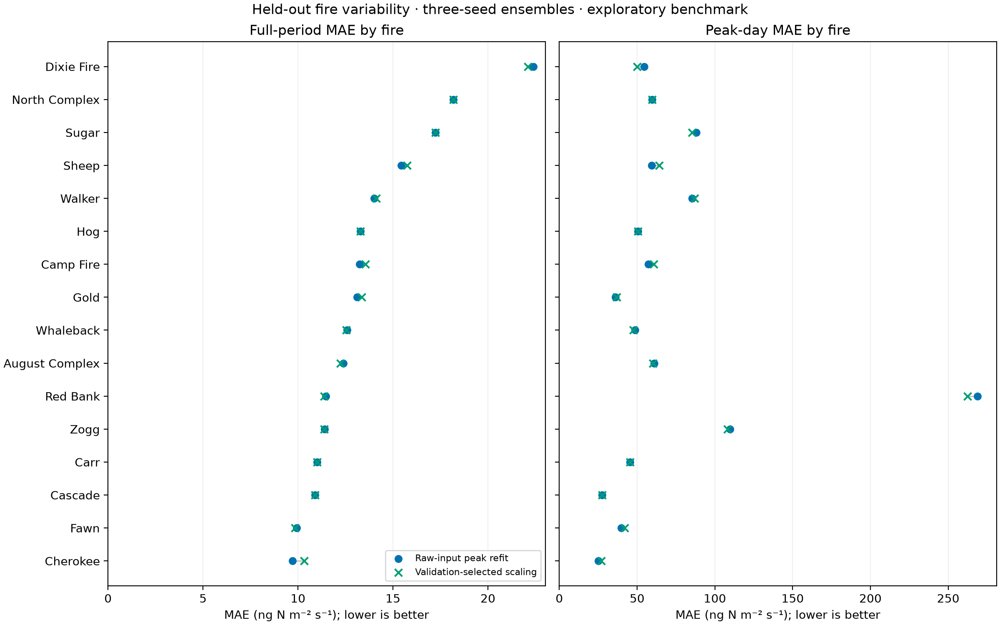

# Estimating Satellite-Derived Post-Wildfire NOₓ Flux

A 2026 NASA SEES Air Quality Initiative project by **Shreya Sahai and Lilybet Downey**, continued after the internship. We investigate how well environmental and past satellite observations can estimate a box-model-derived post-fire NOₓ flux for a fire excluded from model fitting.

**Current status** · Completed exploratory evaluation across **16 fires, 289 fire/plot pairs, and 74,581 post-ignition observations**, using seeds **42, 123, and 7**. The leading predictive profiles are plain neural networks. The tested physics penalties did not improve on their matched data-only control. Large fluxes remain substantially underestimated.

[**Frozen presentation snapshot**](results/final/2026-11-27/README.md) · [All 20 canonical experiments](results/final/2026-11-27/model_results.csv) · [Per-fire results](results/final/2026-11-27/per_fire_results.csv) · [Variability summary](results/final/2026-11-27/variability_summary.csv)

The snapshot is the fixed experiment set for presentation and portfolio review as of 27 November 2026. It includes checksummed tables, per-fire and seed variability, protocols, a source-code archive, and a local artifact inventory. Scientific interpretation and independent validation remain open research tasks.

## What is being predicted

The target is **`soil_nox_tau5hr`**, a satellite box-model-derived flux estimate reported in **ng N m⁻² s⁻¹**. It uses satellite NO₂ columns and reference columns, wind/advection, deposition, lifetime assumptions, and an anthropogenic adjustment. The modeling evaluation measures agreement with that estimate.

**No independent soil-flux measurements were used for validation.** The observed column can contain combustion and other contributions. The current work does not establish a soil-specific emission inventory, operational forecasting accuracy, or accurate recovery of the largest events. The signed estimates include 27,111 negative post-ignition labels, about 36.4%; imposing nonnegative predictions can therefore conflict with the fitted target.

The project combines team box-model exports with Google Earth Engine environmental features. Sources include Sentinel-5P NO₂, Sentinel-2 burn severity, SMAP soil conditions, ERA5-family weather, NASADEM elevation, cropland/land-cover fractions, and MTBS fire perimeters. Earth Engine extraction and export helpers are now available in [`src/`](src/); local input tables and credentials are not included in the portable snapshot.

## Current results

Lower MAE is better. The first error column weights each fire equally; pooled MAE weights each observation equally. Physical R² is calculated on raw flux values across all held-out rows.

| Model or pipeline | Inputs | Equal-fire MAE | Pooled MAE | Physical pooled R² | Extreme-row MAE | Peak-day MAE |
| --- | ---: | ---: | ---: | ---: | ---: | ---: |
| Environment-only NN | 55 | 14.075 | 17.129 | 0.131 | 363.609 | 75.580 |
| XGBoost, physical loss | 55 | 14.236 | 16.825 | 0.118 | 368.163 | 77.432 |
| NN with past NO₂ | 60 | 13.640 | 16.150 | 0.190 | 344.286 | 70.371 |
| Repaired physics penalties | 55 | 14.940 | 17.939 | 0.107 | 364.297 | 75.850 |
| Repaired spatial/wind penalties only | 55 | 14.182 | 17.198 | 0.126 | 364.814 | 76.529 |
| Refitted MSE-validation control | 60 | 13.727 | 16.130 | 0.194 | 343.134 | 70.093 |
| Peak-focused refit, raw inputs | 60 | **13.513** | 16.203 | 0.242 | 321.289 | 62.624 |
| Signed-log refit everywhere | 60 | 13.556 | 16.117 | 0.256 | 311.169 | **62.093** |
| Validation-selected input scaling | 60 | 13.572 | **16.100** | **0.266** | **310.611** | 62.286 |

Bold values identify tradeoffs within this main table, not a separately validated global winner. All 20 unique completed arms, including the lower-MAE capped peak-validation candidate and the more aggressive fivefold tail-weight candidate, remain in the [complete table](results/final/2026-11-27/model_results.csv).

The 60-input models add **strictly earlier** satellite observations from the held-out fire. That information is assumed available at prediction time. The 55-input models use environmental predictors. Later studies also change validation and training-data allocation. Cross-row comparisons therefore do not isolate architecture alone. XGBoost was matched to the environment-only NN inputs; its pseudo-Huber objective differs slightly from NN SmoothL1.

Two profiles are retained for the presentation:

- **Raw-input peak-focused refit** is the equal-fire MAE reference profile. It is not claimed to have the smallest observed test MAE among every exploratory arm.
- **Validation-selected scaling** is the extreme-flux candidate. Relative to the raw-input reference, extreme-row MAE is about 3.3% lower, pooled MAE about 0.6% lower, and equal-fire MAE about 0.4% higher. Extreme-row aggregate underprediction remains about **80%**.

For the scaling-selected comparison, full-period MAE improved on six fires, worsened on six, and was unchanged on four raw-fallback fires. This heterogeneity matters more than a small change in the grand average.



## Neural-network configuration

The shared feedforward architecture has hidden layers of 256, 128, and 64 units with batch normalization, ReLU, and 0.3 dropout. Current NN training uses Adam (learning rate 0.001, weight decay 0.0001), batch size 512, gradient clipping at norm 1, and a 200-epoch ceiling with patience 20 for inner selection. The output parameterizes arcsinh flux; the main data loss is SmoothL1 on decoded physical flux with beta 10 and first-month weight 3. Transformed-loss controls remain in the full snapshot. Final refits use validation-frozen epoch budgets and learning-rate schedules.

## Evaluation and leakage controls

1. **Outer evaluation** holds out one whole fire. Its labels never fit the model, imputation, scaling, target thresholds, early stopping, learning-rate scheduling, or per-fold model choices. Validation and test labels stay raw. Predictions are not clipped using test labels.
2. **Environment/history/physics controls** reserve the last 20% of observed dates within each training fire for validation. Some training arms cap only training labels at their training p1/p99; uncapped arms retain all training labels.
3. **Peak-focused validation** holds out three complete inner fires from the other fifteen. They have early observations and are selected using identifiers, dates, and row counts. Four predefined objectives compare capped targets, uncapped targets, and fivefold high-flux weighting. A training-normalized score combines full-period, first-month, high-row, and peak-day MAE.
4. **Selection guardrail** requires the candidate's full-period inner-validation MAE to be within 5% of the inner arcsinh control. The candidate with the lowest eligible validation peak score is selected. This is a validation constraint, not a guarantee about test error.
5. **Final refitting** starts from scratch on all fifteen non-test fires after objective, input mode, epoch budget, and learning-rate schedule are fixed. Inner validation fires are then training data; the outer fire remains excluded.
6. **Scaling comparison** holds the previously selected loss fixed for both methods. Signed-log (`asinh`) preprocessing changes three past-NO₂ signals, with reference scales fitted on training rows only. Soil/weather transformations and the five-standard-deviation input cap remain in place. Scaling is chosen from validation before refitting, and test scores do not choose it.

Current-day NO₂ and reference columns, target variants, box-model intermediates, and direct identifiers are excluded from NN predictors. The explicitly past satellite features are the added inputs in history models.

The common reporting subsets are 5,771 first-month rows from fourteen fires, 726 extreme rows above frozen training p99 thresholds, and 214 high-flux daily means above frozen training daily-mean p95 thresholds. Thresholds are shared across comparisons. Missing per-fire cohort scores mean too few qualifying observations, not zero error.

**Repeated benchmark development remains a limitation.** These fires were repeatedly examined while designing experiments. Direct train/validation/test leakage was addressed in the current pipelines, but these are exploratory cross-validation estimates rather than a new untouched final test. Additional independent fires or field observations would strengthen the claims.

Percent bias is `100 × sum(prediction − actual) / sum(actual)`. The denominator is signed. Cancellation can make it misleading, so MAE is reported alongside it. Individual-seed ranges describe optimization variability across three seeds; they are not confidence intervals or the variability of three independent datasets.

## What changed during the project

- **Past observations** added a previous NO₂ value, previous column/reference difference, strictly past seven-day mean, observation age, and availability. First-month and peak-day errors improved.
- **Physics repairs** corrected temporal pairing, wind direction, longitude distances, decay normalization, and a hard gradient ceiling. The repaired penalties remained worse than the matched plain NN. The active reference profiles have physics penalties off.
- **Peak-aware selection and uncapped training** improved large-event performance, with tradeoffs on typical/negative-label errors. Model choices were made from inner validation and frozen before outer evaluation.
- **Signed-log inputs** reduced extreme-case history-input saturation from 36.1% to 23.1%; all-three-signal upper saturation fell from 18.2% to zero. Accuracy gains were modest, and average per-fire error slightly increased.

[Physics/information study](results/phase2/information_physics_study/README.md) · [Peak validation/refits](results/phase2/peak_validation_study/README.md) · [Scaling study and step-by-step summary](results/phase2/history_scaling_study/README.md)

## Inspect and verify the frozen results

Portable snapshot verification uses the Python standard library and does not need input data or model weights:

```sh
python3 -m src.freeze_research_results --verify
```

For the tests and current research workflow, use Python 3.11 and the core environment observed at snapshot time:

```sh
python3.11 -m venv .venv
source .venv/bin/activate
python -m pip install -r requirements-research.txt
python -m unittest discover -s tests -v
```

[`requirements-research.txt`](requirements-research.txt) contains the core scientific packages. The older broad [`requirements.txt`](requirements.txt) additionally includes notebook and data-acquisition dependencies. The snapshot's [`environment.json`](results/final/2026-11-27/environment.json) records the observed environment; training used CPU with two Torch threads per worker.

With all original local inputs and cached artifacts available, verify their hashes as well:

```sh
python -m src.freeze_research_results --verify --verify-sources
```

This checks source files, data, predictions, and checkpoints in their recorded original locations. They are not bundled into the portable presentation snapshot. Full scoring/retraining requires those local inputs and the prior control-study artifacts. Credentials are never part of the snapshot.

To reproduce the latest scaling study, copy its frozen manifest into a **fresh** working output directory, then train and score there:

```sh
mkdir -p results/reproduction/scaling
cp results/phase2/history_scaling_study/study_manifest.json results/reproduction/scaling/study_manifest.json
python -m src.history_scaling_study results/reproduction/scaling
python -m src.compare_history_scaling results/reproduction/scaling
```

That command trains all sixteen folds and can take substantial CPU time. Study READMEs document four-worker sharding and other experiments. Comparison scripts write outputs; use a working copy for reruns. Do not overwrite the frozen snapshot or its recorded source artifacts. A revised experiment set should use a new snapshot directory.

## Repository map

| Location | Purpose |
| --- | --- |
| [`src/clean_phase2.py`](src/clean_phase2.py), [`src/extract_new_fire_features.py`](src/extract_new_fire_features.py) | Clean exports and enrich new-fire environmental features |
| [`src/ee_notebook_exports.py`](src/ee_notebook_exports.py) | Earth Engine notebook/export helpers |
| [`src/build_no2_history.py`](src/build_no2_history.py) | Construct strictly past satellite inputs |
| [`src/final_pinn.py`](src/final_pinn.py) | Matched environment/history/physics evaluation with training-only validation |
| [`src/physics_loss.py`](src/physics_loss.py) | Legacy and repaired penalty modes |
| [`src/peak_validation_study.py`](src/peak_validation_study.py), [`src/refit_peak_selection.py`](src/refit_peak_selection.py) | Whole-fire inner validation, objective selection, and full-data refits |
| [`src/history_scaling_study.py`](src/history_scaling_study.py) | Conditional signed-log scaling comparison |
| [`src/compare_history_scaling.py`](src/compare_history_scaling.py) | Validate artifacts and compute paired raw-target metrics |
| [`src/freeze_research_results.py`](src/freeze_research_results.py) | Consolidate the final set and verify snapshot/source checksums |
| [`tests/`](tests/) | Modeling regressions and snapshot-integrity checks |
| [`results/phase2/`](results/phase2/) | Original completed studies and exploratory artifacts |
| [`results/final/2026-11-27/`](results/final/2026-11-27/) | Frozen, portable presentation tables, variability, and provenance |

## Historical results and limits

The original four-fire README is preserved in [`docs/archive/README_original_four_fire.md`](docs/archive/README_original_four_fire.md). Its early runs used held-out-fire information during stopping/scoring and are not the current benchmark. Earlier random-row and grouped XGBoost figures also involved a different NO₂-column target and should not be compared directly to the current flux results.

Some standalone legacy functions remain in `baseline_nn.py`, `pinn.py`, and `data_loader.py` for historical compatibility. Use the current study entry points above for the documented protocol. The existence of legacy code does not make its older preprocessing/scoring the active evaluation method.

The project does not establish a PINN advantage, field-soil accuracy, statistical significance, or deployment readiness. The soil-specific interpretation, box-model units/assumptions, and possible combustion influence need domain/mentor review. The current scope is exploratory estimation assisted by past satellite observations.

## Credits

Developed by Shreya Sahai and Lilybet Downey through the 2026 NASA SEES Air Quality Initiative and continued afterward. The team presented its initial work at the SEES symposium. Implementation and analysis include AI-assisted development with regression tests and artifact-consistency checks; automated checks do not replace domain review.

Project background reference: Huber, D. E., Steiner, A. L., & Kort, E. A. (2020). *Daily cropland soil NOₓ emissions identified by TROPOMI and SMAP*. Geophysical Research Letters, 47(22), e2020GL089949. [DOI](https://doi.org/10.1029/2020GL089949).
