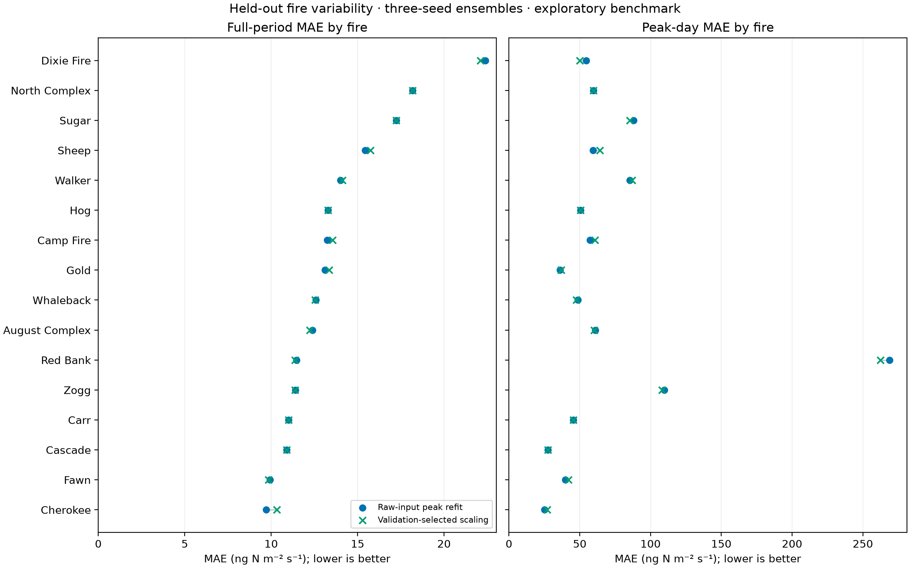

# Frozen presentation results

Snapshot date 2026-11-27, America/Los_Angeles. This freezes the completed experiment set for presentation and portfolio review. No training was run to create it. Scientific/domain review remains pending.

## Evaluation status

All canonical arms cover the same 16 outer fires, 74,581 post-ignition rows and three seeds (42, 123, 7). Model fitting, preprocessing and within-fold selection excluded the outer fire. The benchmark was repeatedly examined during project development. These are exploratory cross-validation results, not a fresh independent final test.

The target is the satellite box-model-derived `soil_nox_tau5hr` estimate in ng N m⁻² s⁻¹. No independent soil-flux measurements were used. Agreement with this target does not establish accuracy against actual soil emissions.

## Main comparisons

| Model | Inputs | Equal-fire MAE | Pooled MAE | Physical pooled R² | First-month MAE | Extreme-row MAE | Peak-day MAE |
| --- | ---: | ---: | ---: | ---: | ---: | ---: | ---: |
| Environment NN, flux loss | 55 | 14.075 | 17.129 | 0.131 | 53.947 | 363.609 | 75.580 |
| NN with past NO2 | 60 | 13.640 | 16.150 | 0.190 | 47.858 | 344.286 | 70.371 |
| Repaired physics penalties | 55 | 14.940 | 17.939 | 0.107 | 54.399 | 364.297 | 75.850 |
| Repaired spatial/wind penalties only | 55 | 14.182 | 17.198 | 0.126 | 54.012 | 364.814 | 76.529 |
| Refitted MSE control | 60 | 13.727 | 16.130 | 0.194 | 47.772 | 343.134 | 70.093 |
| Peak-focused refit, raw inputs | 60 | 13.513 | 16.203 | 0.242 | 47.532 | 321.289 | 62.624 |
| Signed-log refit everywhere | 60 | 13.556 | 16.117 | 0.256 | 47.020 | 311.169 | 62.093 |
| Validation-selected input scaling | 60 | 13.572 | 16.100 | 0.266 | 46.776 | 310.611 | 62.286 |
| XGBoost, physical loss | 55 | 14.236 | 16.825 | 0.118 | 53.387 | 368.163 | 77.432 |

Lower MAE is better. Equal-fire MAE averages the 16 fire-specific ensemble errors. Pooled MAE weights each observation equally. Physical R² is pooled across raw flux values; transformed R² is preserved in the CSV but is a different measure.

The 55-input models use environmental predictors. The 60-input models additionally assume strictly earlier satellite NO2 observations from the outer fire are available at prediction time. This is estimation assisted by past satellite observations. Whole-fire inner validation and refits also change training rows relative to late-date validation. The table is not an architecture-only ranking.

XGBoost is matched to the environment-only NN inputs. Its pseudo-Huber objective differs slightly from NN SmoothL1. Physics comparisons use matched environment inputs, physical data loss and seeds. Repaired physics fixes improve implementation correctness, but the tested penalties do not beat the plain environment NN.

## Frozen interpretation

- The raw-input peak-focused refit is retained as the equal-fire MAE reference profile. This does not assert it has the smallest test MAE among all exploratory candidates.
- Validation-selected scaling is the extreme-flux candidate. It improves extreme-row error modestly while slightly increasing equal-fire MAE. Scaling is selected by inner validation, not outer test scores.
- No single pipeline is best on every metric or every fire. Do not present the smallest observed test metric as a separately validated global model choice.
- Large values remain substantially underestimated. Extreme-row aggregate bias is approximately −82.6% for the raw peak refit and −79.8% for validation-selected scaling.
- The fixed fivefold tail-weight arm has stronger peak-day performance with worse average and negative-label errors. It remains in the complete 20-arm registry rather than being hidden.

The common reporting subsets contain 5,771 first-month rows (days 0–30, 14 fires), 726 extreme rows (above each held-out fold’s frozen training p99), and 214 peak daily means (above the frozen training daily-mean p95). Thresholds are shared across models and stored in `protocols/reporting_thresholds.json`. Internal training/validation thresholds can differ because those fits use different training subsets.

Percent bias is `100 * sum(prediction - actual) / sum(actual)` on the specified cohort. The denominator is signed, not the sum of absolute labels. Bias can be misleading when signed targets cancel; use MAE alongside it. Positive-tail cohort biases are easier to interpret.

## Per-fire and seed variability

| Model | Fire MAE median | Fire MAE IQR | Fire MAE min–max | Individual-seed macro MAE range |
| --- | ---: | ---: | ---: | ---: |
| Environment NN, flux loss | 13.222 | 11.926–14.237 | 10.023–24.601 | 14.138–14.185 |
| NN with past NO2 | 12.914 | 11.261–14.393 | 10.118–22.612 | 13.578–14.005 |
| Repaired physics penalties | 14.440 | 11.802–16.178 | 10.139–26.094 | 14.925–15.085 |
| Repaired spatial/wind penalties only | 13.337 | 11.825–14.345 | 9.988–24.759 | 14.179–14.329 |
| Refitted MSE control | 12.770 | 11.381–14.793 | 9.657–22.825 | 13.724–13.895 |
| Peak-focused refit, raw inputs | 12.840 | 11.294–14.372 | 9.704–22.383 | 13.522–13.650 |
| Signed-log refit everywhere | 12.946 | 11.259–14.520 | 9.850–22.095 | 13.491–13.879 |
| Validation-selected input scaling | 12.915 | 11.284–14.520 | 9.850–22.095 | 13.481–13.892 |
| XGBoost, physical loss | 13.685 | 11.816–14.910 | 10.200–23.271 | 14.157–14.345 |

For scaling-selected versus raw peak-refit full-period MAE, 6 fires improved, 6 worsened, and 4 were unchanged. Missing peak/first-month scores mean the fire has too few qualifying observations; they are not zero error.

Fire distributions describe heterogeneity across 16 evaluated fires. Seed ranges and population standard deviations describe three fixed optimization seeds. Neither is a confidence interval. Individual-seed macro MAE is computed before ensembling and differs from the macro MAE of the averaged predictions. Rows within a fire are correlated and do not create tens of thousands of independent tests.

## Snapshot contents and verification

- `model_results.csv` contains all 20 unique completed canonical arms; `headline_results.csv` is the nine-row main table.
- `per_fire_results.csv` and `per_seed_results.csv` contain all 320 fire rows and 960 fire/seed rows. `variability_summary.csv` and `paired_scaling_changes.csv` make the spread and tradeoffs explicit.
- `experiment_registry.json` pins each canonical arm to its original study and feature/validation assumptions. Repeated aliases across study tables are deduplicated.
- The final set covers the five study families in that registry. Earlier four-fire runs and initial all-fire physics/unit explorations remain outside this presentation snapshot and are not used for its headline claims.
- `protocols/` copies original manifests, selection records and reporting thresholds. Superseded/incomplete physics outputs and the initial capped XGBoost ceiling pilot are excluded.
- `code_snapshot.zip` captures current repository Python sources, tests, dependency files and README. Original study manifests retain historical code hashes, which can differ from the current source snapshot. The archive does not claim bitwise reconstruction of every earlier training execution.
- `source_inventory.json` hashes original study outputs, predictions, checkpoints and input tables in their existing locations. They are not copied into this portable summary snapshot. Data and weights remain subject to their separate availability and sharing arrangements.
- `snapshot_lock.json` hashes every packaged file. The builder refuses to replace an existing snapshot directory. A changed snapshot requires a new output/version.

From the project root, run `python -m src.freeze_research_results --verify` for packaged-file checks, or add `--verify-sources` to check all original local inputs and artifacts. The latter requires the local data/checkpoints. Neither command trains a model.

## Claims to keep out of the presentation

Do not claim validated field-soil emissions, operational forecasting accuracy, a PINN advantage, a fresh untouched final test set, or statistical significance from three seeds. Do not use the original four-fire/random-row scores as the current benchmark. Archived historical descriptions are in `docs/archive/README_original_four_fire.md` at the repository root.

Mentor review of box-model units, combustion contamination and the soil-specific interpretation is still pending. More independent fires or field observations would strengthen the scientific claims.
