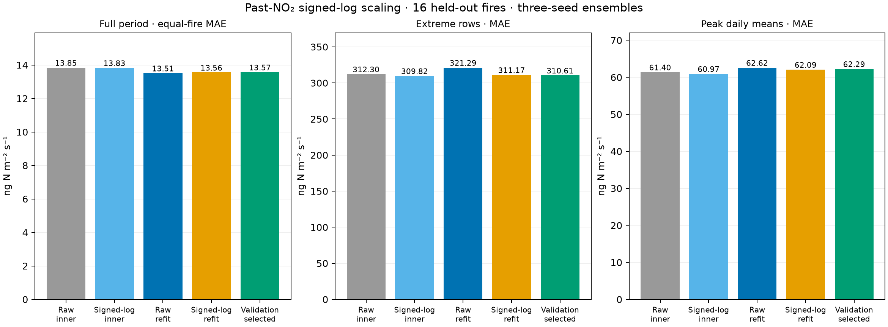

# Past-NO2 signed-log scaling experiment

## Summary of steps 3 onward

- **Step 3, past satellite inputs.** Added the previous observed NO2, its difference from the previous reference, a strictly past seven-day NO2 mean, observation age, and availability. Today's values never enter these features. Across 16 held-out fires and three seeds, environment-only equal-fire MAE improved from 14.07 to 13.64 and peak-day MAE from 75.58 to 70.37. Earlier satellite measurements from a new fire are assumed available.
- **Step 4, physics audit and repairs.** Corrected same-date/same-fire pairing, wind direction, longitude distances, decay normalization, and a hard ceiling that could eliminate the physics gradient. These were real implementation fixes. The repaired penalties still had MAE 14.94 against the matched environment-only NN's 14.07. Keeping only spatial/wind penalties gave 14.18. The leading predictive models therefore remain plain neural networks with physics penalties off.
- **Afterward, peak-focused validation and objectives.** Replaced late-date-only validation with three whole inner validation fires containing early observations. Compared capped, uncapped, and fivefold high-flux weighting objectives under a fixed normalized peak score. All selection and thresholds excluded the outer test fire.
- **Final refits.** After settings were fixed, trained on all fifteen non-test fires. The validation-selected pipeline reached equal-fire MAE 13.51 and peak-day MAE 62.62, versus 13.64 and 70.37 for the earlier history model. That is about 1% lower per-fire error and 11% lower peak-day error. Pooled error across all rows remained nearly unchanged. Extreme-row aggregate underprediction remained about 83%.
- **Input saturation audit.** At least one of the three history signal values hit the five-standard-deviation ceiling in 36.1% of extreme rows; all three hit it in 18.2%. This motivates the present scaling experiment, but does not prove clipping caused the remaining errors.

Earlier reports are in `../information_physics_study` and `../peak_validation_study`.

## Completed scaling results

All sixteen fires and three seeds completed both inner selection and full-data signed-log refitting. All 18 regression tests, the integration smoke, source checks, fitted-statistic checks, 96 new checkpoint dimension checks, saved validation optimum checks, frozen-choice checks, refit schedule checks, and prediction replays passed. No candidate reached the 200-epoch ceiling. The cached raw-scaling control was unchanged.

Errors are in ng N m⁻² s⁻¹. Full-period MAE gives each fire equal weight; other cohorts pool their rows or daily means. Lower is better.

| Pipeline | Equal-fire MAE | Pooled MAE | First-month MAE | Extreme-row MAE | Peak-day MAE | Pooled physical R² |
| --- | ---: | ---: | ---: | ---: | ---: | ---: |
| Raw inputs, inner models | 13.845 | 16.582 | 48.641 | 312.300 | 61.399 | 0.252 |
| Signed-log inputs, inner models | 13.830 | 16.374 | 47.025 | 309.818 | 60.966 | 0.266 |
| Previous raw-input refit | 13.513 | 16.203 | 47.532 | 321.289 | 62.624 | 0.242 |
| Signed-log refit everywhere | 13.556 | 16.117 | 47.020 | 311.169 | 62.093 | 0.256 |
| Validation-selected scaling, refitted | 13.572 | 16.100 | 46.776 | 310.611 | 62.286 | 0.266 |

Validation selected signed-log scaling for twelve fires and retained raw scaling for four. Against the previous raw-input refit, this selected pipeline reduced extreme-row MAE by about 3.3%, first-month MAE by 1.6%, pooled MAE by 0.6%, and peak-day MAE by 0.5%. Equal-fire MAE increased by about 0.4%. Six fires improved, six worsened, and the four raw-fallback fires were unchanged. This is a small tradeoff rather than a clear accuracy win across all measures.

Using signed-log scaling for every fire gave a similar result. Equal-fire MAE increased 0.32%, pooled MAE fell 0.53%, extreme-row MAE fell 3.15%, and peak-day MAE fell 0.85%. Eight fires improved and eight worsened on full-period MAE. These fixed-arm test results did not choose the validation-selected pipeline.

Extreme-row aggregate underprediction for the selected scaling pipeline improved from 82.64% to 79.79%. Peak-day aggregate underprediction remained nearly unchanged, about 68.5%. Large emissions remain substantially underestimated.

The signed-log transformation reduced extreme-row saturation of at least one history signal from 262/726 rows, 36.1%, to 168/726 rows, 23.1%. Simultaneous upper saturation of all three signals fell from 132/726 rows, 18.2%, to zero. Across all rows, any-signal clipping fell from about 1.0% to 0.6%. These clipping figures compare raw and signed-log preprocessing applied everywhere; the validation-selected pipeline mixes the two methods by fire.



## Interpretation and next priorities

The transformation preserves more information in large history values and gives a modest observed benefit on extreme-row error. The remaining peak errors are large, so saturation alone does not explain the original underprediction.

Preserve the previous raw-input refit as the equal-fire MAE baseline. Keep the validation-selected scaling pipeline as an experimental candidate for the extreme-flux objective, with its small per-fire error tradeoff documented. The signed-log scaling comparison holds earlier loss choices fixed; it is not a joint loss/scaling search.

The next bounded experiment could compare milder high-flux weights, such as two and three, under the same inner-fire selection rule. That can test whether extreme performance improves with less overshoot on typical and negative-label cases than fivefold weighting. This follow-up has not been run here. Independent-fire or field validation is still needed before interpreting repeated benchmark gains as final predictive accuracy.

## Fixed comparison protocol

The paired control is the previous raw-scaling, validation-selected pipeline, including its cached inner models and full-data refits. For each outer fire, its previously chosen loss is held fixed for both scaling methods. This isolates the scaling change and avoids a new joint loss/scaling search. Both methods use the same 60 inputs, architecture, three seeds, inner fire split, optimizer, epoch ceiling, early-stopping patience, target policy, sample weights, and land-cover representation options.

Only three input values change

- `no2_previous_observed`
- `delta_no2_previous_observed`
- `no2_past_week_mean`

For each signal, first impute missing raw values using its training median. Compute a reference scale from the median nonzero absolute training value, with a scale of one for an all-zero training signal. Transform as `asinh(raw / reference_scale)`. Then fit the usual standardization on training rows and retain the existing five-standard-deviation cap. This signed-log-like transform preserves zero, negative values, and ordering while compressing large magnitudes. Age, availability, soil, weather, and other inputs retain their transformations.

No validation or test value fits imputation, signal reference scales, or standardization. Unit tests check this independence and confirm that non-signal input columns retain their original scaling.

Epoch, land-cover mode, and learning-rate schedule are reselected from the same inner validation for the transformed inputs. After all three seeds finish, choose signed-log scaling only if its validation-ensemble peak score is lower than raw scaling and its full-period validation MAE is at most 1.05 times the original inner arcsinh control. This keeps the previous bulk-error guardrail and avoids compounding separate five-percent allowances. Otherwise retain raw scaling.

Each per-fire scaling decision is written before the transformed model is refitted. Refit from scratch on all fifteen non-test fires using the chosen transformed mode, epoch count, and replayed inner learning-rate schedule. Fit the transformed preprocessing again on those fifteen fires. Train the transformed candidate even when validation chooses raw so the full paired comparison is available. Final evaluation reports raw, signed-log, and validation-selected scaling. Test metrics never choose the scaling method.

## Verification and artifacts

All 18 regression tests and a one-epoch end-to-end scaling/refit smoke test passed before full launch. The study includes 96 inner candidate fits and 48 full-data refits. The cached raw control is reused unchanged. `study_manifest.json` freezes the data, source code, previous choices, and control reports.

Run one worker or use four disjoint shards

```sh
venv/bin/python -u -m src.history_scaling_study results/phase2/history_scaling_study --shard 0 --shards 4
```

A complete run needs shards zero through three. Completed folds are protected against accidental replacement.

After every fire finishes, run

```sh
venv/bin/python -m src.compare_history_scaling results/phase2/history_scaling_study
```

The checker validates source hashes, fold separation, identical targets, training-only transforms and thresholds, selected validation optima, ensemble arithmetic, refit schedules, checkpoint dimensions, and prediction replays. It freezes an aggregate selection record before opening outer-test prediction files. Results use the same 74,581 raw outer-test rows and frozen reporting thresholds as earlier experiments. Reports also quantify residual clipping under both scaling methods.

This remains exploratory evaluation against satellite box-model labels on repeatedly examined fires. The experiment does not establish independent field accuracy or the best joint loss/scaling configuration.
