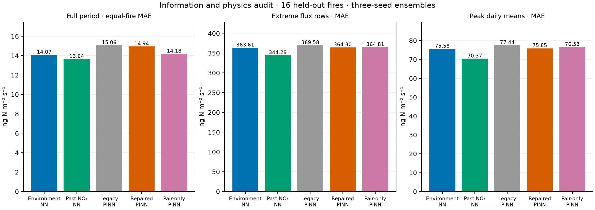

# Past satellite information and physics penalty audit

This study tests two explanations for missed high fluxes. Environmental inputs may lack the satellite signal driving the box-model target, and the physics regularizers may suppress useful predictions or lose their gradients.

## Completed results

All four new experiments completed all 16 held-out fires and three seeds. The existing environment-only control was verified alongside them. All arms have the same 74,581 post-ignition test rows and unmodified target values. The report checker verified every seed checkpoint's input dimension, finite predictions, seed ensemble arithmetic, source hashes, fold sizes, and recomputed metrics. Nine regression tests passed. No selected model reached the 200-epoch ceiling.

Errors below are in ng N m⁻² s⁻¹. Lower is better. Full-period MAE gives each fire equal weight. First-month, extreme-row, and peak-day scores pool their respective subsets.

| Model | Full-period MAE | First-month MAE | Extreme-row MAE | Peak-day MAE | Pooled physical R² |
| --- | ---: | ---: | ---: | ---: | ---: |
| Environment NN | 14.075 | 53.947 | 363.609 | 75.580 | 0.131 |
| Past NO2 NN | **13.640** | **47.858** | **344.286** | **70.371** | **0.190** |
| Legacy PINN | 15.057 | 53.707 | 369.576 | 77.439 | 0.089 |
| Repaired PINN | 14.940 | 54.399 | 364.297 | 75.850 | 0.107 |
| Pair-only PINN | 14.182 | 54.012 | 364.814 | 76.529 | 0.126 |

Past NO2 improved equal-fire MAE by 3.09%, first-month MAE by 11.29%, and peak-day MAE by 6.89%. It beat the environment NN on 12 of 16 fires. Each individual seed also had lower mean per-fire MAE than its corresponding environment-only seed, although improvement varied across seeds. Extreme-row aggregate underprediction improved from 93.91% to 88.94%. The largest fluxes remain poorly captured.

Repairing the penalties modestly improved over legacy physics, but full repaired physics still had 6.15% higher equal-fire MAE than the plain NN. Removing nonnegative and decay penalties reduced that gap to 0.76%; the pair-only arm won on eight fires and lost on eight. The corrected calculations are useful implementation fixes, but these experiments provide no accuracy advantage for the tested penalties and weight.

Negative-label MAE was 17.65 for the environment NN, 16.81 for the history NN, 20.83 for legacy physics, 20.64 for repaired physics, and 18.05 for pair-only physics. This supports concern about the nonnegative/decay assumptions when fitting these signed estimates. Their separate effects are not identified by this joint ablation.

Across all candidate training batches, the legacy hard ceiling eliminated the physics gradient in 0.147% of batches. The repaired arms had zero hard-ceiling activity, including batches whose raw penalty exceeded 1000. Thus the gradient problem was real but rare in this matched-loss experiment; it does not explain the overall accuracy deficit by itself. The legacy mean raw decay component was about 11,325, versus 2.16 with stable normalization, reflecting rare large legacy spikes. The means describe different training trajectories and are not a controlled single-batch comparison. Corrected batches averaged about 35.9 eligible directed spatial pairs.

The main comparison includes 5,771 first-month rows, 726 above-training-p99 rows, and 214 high-flux daily means. Thresholds are fixed across arms and come only from each outer fold's training rows.



## Recommended next experiment

The validation-and-objective follow-up described here is now complete. See [the peak-validation study](../peak_validation_study/README.md) for its frozen protocol, refits, and results.

Use the past-NO2 plain NN as the leading experimental candidate where prior satellite observations are available. Preserve the environment-only NN for prediction settings without that information. Retain corrected physics code for further research, with the tested physics variants as comparisons.

The highest-priority follow-up is validation aligned with the first-month and peak-flux goal. The current final-20%-of-dates validation mostly evaluates later post-fire conditions and selects with arcsinh MSE. Define inner validation fires using only the outer training fires, with an explicit physical-flux score that includes early and high-flux behavior. Keep the outer test fire excluded from this selection. Then compare the history model's existing capped objective against a small predeclared set of tail-focused alternatives, including uncapped training with a smooth robust loss and carefully normalized high-flux weighting. Examine history-feature scaling separately if strong prior NO2 values are frequently clipped. These follow-up experiments have not been run in this study.

All performance comparisons here are exploratory. The repeatedly examined outer-fire results should not be treated as a fresh independent final test.

## Evaluation protocol

Each of the 16 fires is held out once. Its target labels are excluded from training, validation, preprocessing fits, early stopping, and land-cover representation selection. Within the other fires, the last 20% of observed dates form validation. Only training labels are capped at their fold's first and 99th percentiles. Validation and test labels retain their original values.

All arms use three seeds, the same neural architecture, physical-flux SmoothL1 data loss with beta 10, first-month weight 3, and standardized inputs capped at 5 standard deviations. Validation uses arcsinh MSE. This preserves the previous evaluation protocol, although that validation objective can favor typical values over rare physical-flux extremes.

The environment-only NN reuses the completed `target_cap_study/flux_capped` arm. Physics runs use the same 55 NN inputs. The history NN uses 60. Absolute dates and fire IDs used to construct physics pairs are raw loss context only and never NN inputs.

## Arms

| Arm | Additional information or penalty |
| --- | --- |
| Environment NN | Existing best plain NN control |
| Past NO2 NN | Strictly earlier satellite observations within seven days |
| Legacy PINN | Original nonnegative, decay, spatial, and wind penalties |
| Repaired PINN | Same four penalties with corrected pairing, wind direction, stable decay scaling, and smooth penalty compression |
| Pair-only PINN | Corrected spatial and wind penalties with nonnegative and decay weights zero |

The physics multiplier is fixed at 0.01. Internal weights remain nonnegative 2, decay 0.1, spatial 0.3, and wind 0.3 except the explicitly disabled pair-only terms. Box and deposition penalties are off in all three physics arms. No physics weight search is part of this experiment.

## Step 3 audit

The new inputs are the previous observed NO2 column, its difference from the previous reference column, mean NO2 over the preceding seven days, observation age, and availability. Today's value is excluded. Previous observations older than seven days are missing and imputed using the training-fold median. Age is capped at eight days. Pre-ignition observations are allowed when available.

The history arm assumes prior satellite observations from the held-out fire are available at prediction time. It evaluates estimation assisted by past satellite observations. Comparing it with the environmental NN measures the value of this additional information under that availability assumption. It does not establish environmental-only forecasting skill or independence from the satellite retrieval system.

`information_audit.json` and `information_correlations.csv` describe correlations with the box-model label. Current-day advection has correlation 0.983 with the label, current-day NO2 minus reference has correlation 0.900, and the previous observed difference has correlation 0.450. The current-day components reconstruct the label to numerical precision after a constant offset. These are diagnostics of label construction. Current-day NO2, reference NO2, advection, and deposition remain excluded from the NN features.

## Step 4 audit and repairs

Only about 0.288% of the legacy spatial comparison pairs in the audited first training epochs meet the intended same-date, same-fire, distinct-plot criteria. The legacy denominator also includes self-pairs. The audit uses seed 42, all 16 outer folds, and the original DataLoader shuffle. Corrected random batches retain about 35 eligible directed pairs per batch at the median across folds, so the sampler is unchanged.

Corrected pairs use the same absolute UTC date, same fire, distinct coordinates, and distance below 20 km. Longitude distances include the mean-latitude cosine. Wind direction points from source to destination. These penalties remain heuristic assumptions about flux similarity and downwind behavior. Atmospheric transport acts on concentrations, so fixing implementation errors does not validate a transport law for soil emission flux.

The repaired decay term divides by mean absolute predicted flux with a floor of one flux unit, avoiding cancellation of a signed batch mean. Its 30-day envelope remains a modeling assumption. About 36.35% of these signed box-model targets are negative, motivating the pair-only ablation.

The old effective penalty is `min(raw, 1000)`, which gives zero physics gradient above the ceiling. The repaired effective penalty is `1000 * log1p(raw / 1000)`, which preserves a positive derivative. Data-loss backpropagation remains active in either configuration. Actual training histories record both threshold exceedances and hard-clamp activity.

The repaired arm changes several penalties together. It tests the combined repair and does not attribute any accuracy change to one individual correction. Log compression also changes effective regularization strength below the old ceiling. The pair-only arm further tests the effect of removing two assumptions under the repaired implementation.

## Validation and artifacts

The repaired modes are explicitly selected with `--physics-repairs`. Legacy defaults remain available for reproducing earlier experiments. For a new repaired run, use a fresh output directory

```sh
venv/bin/python -u src/final_pinn.py \
  --data data/phase_2_all_fires_model.csv --post-fire-only \
  --input-z-limit 5 --select-land-cover --physics-ablation \
  --physics-repairs --acute-weight 3 --flux-loss-beta 10 \
  --models repaired_pinn --save-histories \
  --output results/phase2/reproduction/repaired_pinn
```

Use `legacy_pinn` or `pair_only_pinn` in `--models` to reproduce those arms with separate output directories. The history run uses `data/phase_2_no2_history_model.csv`, omits `--physics-repairs`, `--models`, and `--save-histories`, and adds `--baseline-only`. All runs default to the study's three seeds and 200-epoch ceiling.

Run `venv/bin/python -m unittest discover -s tests -v` for causal-history and physics-gradient regression checks.

Run `venv/bin/python -m src.compare_information_physics results/phase2/information_physics_study` after all experiments complete. It verifies source hashes, 16 held-out folds, all three checkpoints per fire, input dimensions, finite predictions, seed ensemble arithmetic, frozen targets, fold sizes, and saved metrics. All arms use the control study's fixed training-only thresholds for high rows, extreme rows, and peak daily means.

The comparison writes `summary.json`, `per_fire_comparison.csv`, `per_seed_comparison.csv`, `physics_training_telemetry.csv`, and `comparison.png`. Telemetry aggregates actual training batches, with candidate-mode and selected-mode summaries. It does not infer training clamp frequency from saved checkpoints.

The incomplete physics outputs generated before a decay-option wiring correction are archived in `superseded_incomplete_before_decay_wiring_fix` and excluded. Both corrected arms restarted from scratch. The history and legacy runs were unaffected by that option. Source hashes and provenance are recorded in `study_manifest.json`.

All target values are satellite box-model estimates. Agreement with them does not establish accuracy against independent field measurements. These experiments are exploratory comparisons on repeatedly examined held-out fires. A final scientific claim needs an independent fire or other external validation source.
