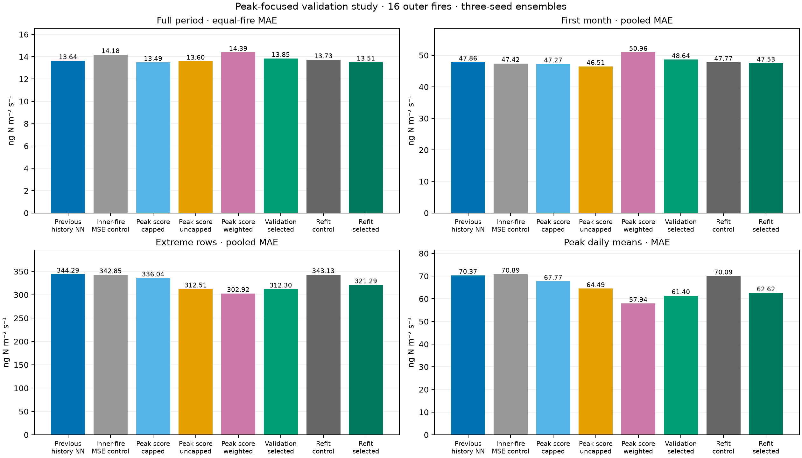

# Peak-focused validation and training study

## Completed results

All four candidate arms and both final-refit pipelines completed 16 outer fires and three seeds. They share the same 74,581 raw held-out rows. Validation-only choices were saved and hashed before refits and outer evaluation. The checker passed source hashes, fold membership, fitted-statistic comparisons, seed ensemble arithmetic, saved validation optima, fixed refit budgets/schedules, all 288 new checkpoint dimensions, and checkpoint prediction replays. No candidate reached the 200-epoch ceiling. All 14 distinct regression tests passed, including the added fixed-schedule test.

Errors are in ng N m⁻² s⁻¹. Full-period MAE weights fires equally. The other error columns pool the corresponding fixed reporting cohorts. Lower is better.

| Model or pipeline | Full-period MAE | First-month MAE | Extreme-row MAE | Peak-day MAE | Pooled physical R² |
| --- | ---: | ---: | ---: | ---: | ---: |
| Previous history NN | 13.640 | 47.858 | 344.286 | 70.371 | 0.190 |
| Inner arcsinh control | 14.180 | 47.418 | 342.854 | 70.892 | 0.187 |
| Peak score, capped | 13.491 | 47.272 | 336.038 | 67.769 | 0.211 |
| Peak score, uncapped | 13.598 | 46.512 | 312.511 | 64.488 | 0.254 |
| Peak score, weighted | 14.394 | 50.960 | 302.919 | 57.945 | 0.251 |
| Validation-selected, before refit | 13.845 | 48.641 | 312.300 | 61.399 | 0.252 |
| Refit arcsinh control | 13.727 | 47.772 | 343.134 | 70.093 | 0.194 |
| **Validation-selected, refitted** | **13.513** | **47.532** | **321.289** | **62.624** | **0.242** |

The final validation-selected refit is a modest improvement toward capturing large fluxes. Relative to the previous history NN, equal-fire MAE fell 0.93%, first-month MAE fell 0.68%, extreme-row MAE fell 6.68%, and peak-day MAE fell 11.01%. It improved full-period MAE on nine of sixteen fires. Pooled MAE across all rows rose slightly from 16.150 to 16.203, a 0.33% increase, so there is no clear improvement on that average-error measure. Negative-label MAE increased 6.92%, from 16.81 to 17.97.

Against the matched refitted arcsinh control, the selected refit reduced equal-fire MAE by 1.56%, extreme-row MAE by 6.37%, and peak-day MAE by 10.66%. Pooled MAE was 0.45% higher. Thus peak-focused selection helps large events in this comparison while retaining a small tradeoff on pooled and negative-label errors.

Extreme-row aggregate underprediction improved from 88.94% to 82.64%. Peak-day aggregate underprediction improved from 79.44% to 68.41%. Large events remain substantially underestimated. Higher pooled physical R², from 0.190 to 0.242, also remains modest.

Validation chose uncapped, unweighted-tail training for nine fires, uncapped fivefold tail weighting for six fires, and capped peak-score training for one. All choices satisfied the validation-only 5% full-MAE guardrail. This rule does not guarantee a test-error bound. The smallest observed equal-fire MAE among the fixed candidate arms belonged to capped peak-score training, but that outer-test observation did not choose the final refitted pipeline.

Applying fivefold tail weighting universally gave the best peak-day error among the fixed candidates, but raised equal-fire MAE by 5.53%, first-month MAE by 6.48%, and negative-label MAE by about 30.5% relative to the previous model. It should be treated as a peak-emphasis tradeoff rather than a universal replacement.



## Remaining limitation and recommended next test

The post-evaluation clipping audit found that at least one of the three NO2-history signal values reaches the positive five-standard-deviation ceiling on 742 of 74,581 rows, about 1.0% overall, but on 262 of 726 extreme rows, about 36.1%. All three history signal values reach the ceiling on 132 extreme rows, about 18.2%. This saturation removes some distinction among large input values. It does not establish that clipping caused the remaining errors.

The highest-priority next test is a training-fitted signed-log/asinh transformation of the three history signal inputs before standardization. Keep the same nested validation, frozen selection rule, and outer evaluation, with a matched existing-scaling control. This tests whether retaining more detail at high NO2 values improves peaks. A subsequent small comparison of tail multipliers 2 and 3 could test a milder tradeoff than the current factor 5. These follow-up training experiments have not been executed here.

The refitted selected pipeline is the leading candidate for the large-flux objective. Preserve the previous history NN as a benchmark for pooled and negative-label accuracy. Independent-fire evaluation remains necessary before treating the exploratory gains as final scientific evidence.

## Protocol

This is a prospective comparison of a past-NO2 neural network under four predefined validation/objective combinations. All use the same 60 inputs, neural architecture, optimizer, seeds 42/123/7, batch size 512, 200-epoch ceiling, patience 20, and standardized input cap of five standard deviations. Physics penalties are off. Prior satellite measurements from the outer fire are allowed as prediction-time inputs. Its target labels never enter fitting, preprocessing, thresholds, stopping, or objective selection.

For each of 16 outer test fires, three complete inner fires become validation. Each validation fire must have at least three first-month observation dates. Triplets containing 15–35% of the remaining rows are chosen by a deterministic hash of identifiers; a nearest-20% fallback is defined for datasets without such triplets. Only identifiers, dates, and row counts determine the split. This prevents very small validation groups while permitting the largest fires in validation. All 14 fires with early observations appear in validation across the 16 folds. Cascade and Cherokee retain their later observations for training or outer testing but are ineligible as inner validation fires.

Actual validation row fractions range from 16.1% to 34.8%. Consequently the previous history NN and this study have different training rows and sometimes different training-data amounts. The four new arms share exactly the same inner splits and fitted preprocessing. The inner arcsinh control allows the selection objective to be compared within the new split protocol.

## Predeclared arms

| Arm | Training labels | Training weights | Validation selection |
| --- | --- | --- | --- |
| Inner arcsinh control | Training p1/p99 capped | First month ×3 | Pooled arcsinh MSE |
| Peak score, capped | Training p1/p99 capped | First month ×3 | Peak composite |
| Peak score, uncapped | Raw | First month ×3 | Peak composite |
| Peak score, weighted | Raw | First month ×3, above-training-p95 rows ×5 | Peak composite |

All training objectives are physical-flux SmoothL1 with beta 10. Weights multiply, so a first-month high-flux row receives weight 15 in the weighted arm. Each batch divides its weighted loss by its weight sum. Only positive high-flux labels above the training p95 receive the tail multiplier. Test and validation labels remain raw in every arm. Epoch and standardized/native land-cover mode are selected separately for each seed using the arm's validation criterion. These four candidate arms are retained without refitting. Additional final pipelines are defined in the prospective extension below.

## Peak validation score

The fixed score combines equal-fire MAE on four cohorts

- Full period, weight 0.4
- First month, weight 0.2
- Above-training-p95 rows, weight 0.2
- Above-training-p95 daily means, weight 0.2

Each error is divided by the corresponding training-cohort MAE of a constant training-median predictor, floored at one flux unit. Thresholds and normalizers come exclusively from inner training. Eligible fires contribute equal weight within each cohort. Peak-day predictions average plots within each fire/date before scoring. Cohorts deliberately overlap. Every planned validation group has early, high-row, and peak-day coverage.

After all seeds finish, each arm's validation ensemble receives this same score. For each outer fold, the selected arm is the minimum-score arm whose full-period validation MAE is at most 1.05 times the inner arcsinh control. The control is always an eligible fallback. This guardrail limits validation regressions; it cannot guarantee the same limit on outer-test error.

`validation_selection.json` is persisted by the comparison script before it reads any outer-test prediction files. Candidate test scores never choose the final arm.

## Verification and reporting

To reproduce an arm in a fresh directory, run the following from the project root and replace the arm name and output directory for each comparison

```sh
venv/bin/python -u -m src.peak_validation_study \
  --arm inner_peak_capped \
  --output results/phase2/reproduction/inner_peak_capped
```

`split_plan.json` and `study_manifest.json` freeze the splits, thresholds, scales, source hashes, objectives, and selection rule before full training. All 13 regression tests passed before launch. Four one-epoch integration runs also passed. Earlier split-design smoke outputs live only under `/tmp` and are excluded.

All three checkpoint seeds in all four arms also passed a validation-prediction replay for August Complex after its first full fold finished. This early check verified training fits and recorded validation scores without evaluating outer-test performance.

To reproduce the completed verification and comparison, run

```sh
venv/bin/python -m src.compare_peak_validation results/phase2/peak_validation_study
```

The script verifies fold membership, source/code hashes, identical preprocessing among new arms, training-derived thresholds, raw targets, finite seed predictions, checkpoint dimensions, selected input modes, and saved validation scores. It replays all three saved checkpoints on both validation and test for the first outer fire in all four arms.

Outer results compare all four arms, the validation-selected pipeline, and the previous history NN on the same 74,581 rows. Reporting thresholds are the frozen earlier study thresholds, shared across all arms. They differ intentionally from the new inner-training thresholds used for fitting and validation. Outputs include per-fire/per-seed metrics, daily predictions, a summary, and figures.

The experiment is exploratory and uses repeatedly examined outer fires. All labels are satellite box-model estimates. Improvement here does not establish accuracy against independent field measurements.

## Prospective final-refit extension

Before reading outer-test performance, a final-refit extension was recorded in `refit_extension.json`. The original four no-refit candidate arms remain unchanged. Two additional pipelines refit the inner arcsinh control and the validation-chosen arm on all fifteen outer-training fires. These paired refits restore training data from the three inner validation fires after selection is complete. The outer test fire remains excluded.

Each seed starts from scratch using its already selected input mode and best epoch count. Its learning-rate schedule is reconstructed from the saved inner-validation score sequence and fixed before refitting. Refits have no validation or test feedback. Median imputation, scaling, target cap thresholds, and tail-weight thresholds are fitted again on all fifteen training fires. If the selected arm is the control, its identical refit is reused.

The refitted pipelines use more training rows than the earlier history NN, which reserved late dates for validation. Comparisons between the two refitted pipelines have matching data and preprocessing. The non-refitted arms separately show the original matched inner-training comparisons.

To freeze all validation decisions without reading test predictions, use `--select-only` with the comparison script. `refit_plan.json` then records the decision-file hash and the predeclared refit code hashes. Run `src.refit_peak_selection` after that plan is frozen. The final comparison requires every refit to finish before it reads outer-test prediction files.
